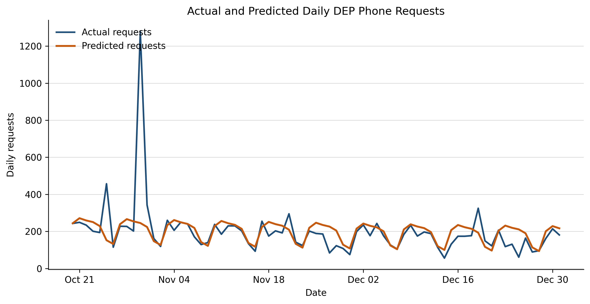
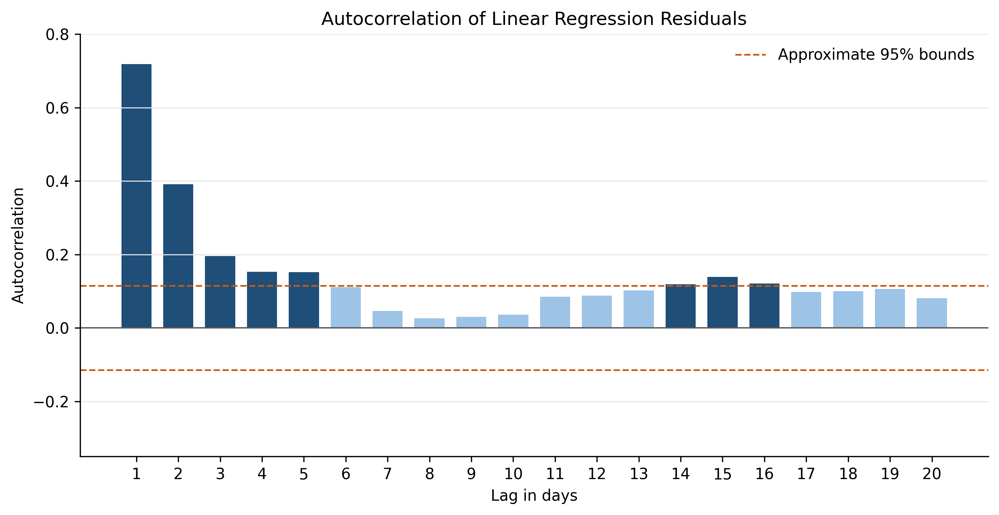
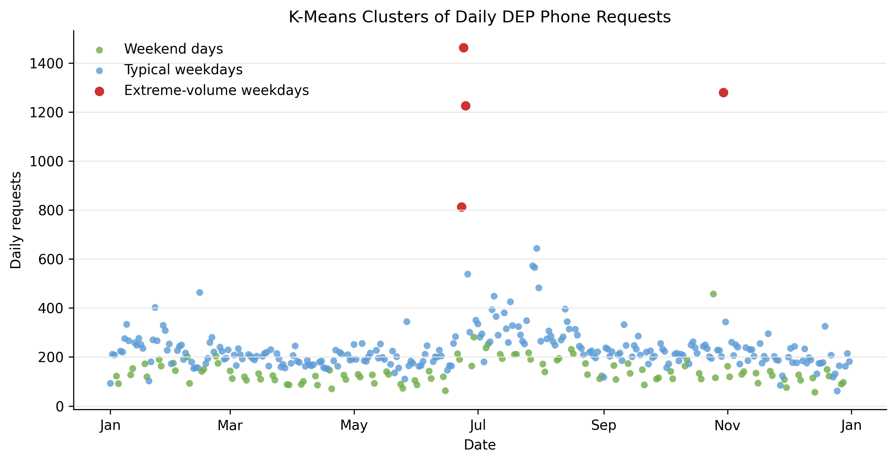
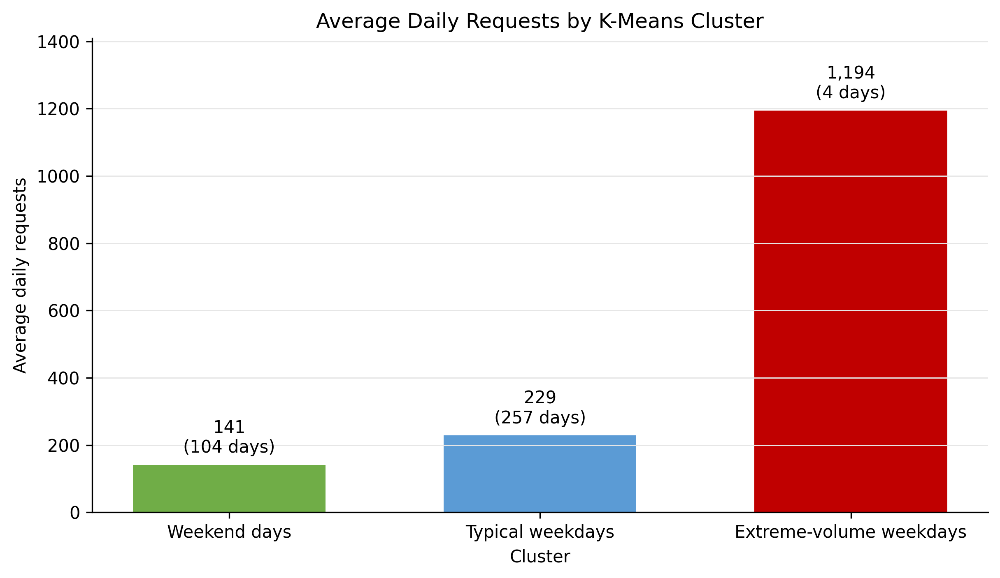

# Forecasting Daily NYC 311 DEP Phone Demand

This project examines whether historical NYC 311 telephone-request patterns can provide a useful forecast of daily demand assigned to the New York City Department of Environmental Protection (DEP). The goal is to give managers a better starting point for planning workload before the day begins.

## Business question

Can calendar patterns in historical 311 records improve a daily demand forecast compared with a simple average-based baseline?

## Data

- Source: [NYC OpenData — 311 Service Requests from 2020 to Present](https://data.cityofnewyork.us/d/erm2-nwe9)
- Period: January 1 through December 31, 2025
- Agency: `DEP`
- Channel: `PHONE`
- Filtered requests: **78,211**
- Final analytical structure: **365 daily observations**

The repository contains the daily aggregate used for modeling, not the much larger raw service-request export. See [data/README.md](data/README.md) for the field definitions and filters.

## Methods

Two models were used for different purposes:

1. **Linear regression** estimated daily volume from day-of-week indicators and annual sine and cosine terms. The first 292 days were used for training and the final 73 days were reserved for testing.
2. **K-means clustering** grouped days with similar request volume and weekend status. It was used to describe demand profiles rather than predict an exact count.

The regression was compared with a baseline that predicted the training-period average for every test date.

## Key results

| Measure | Linear regression | Mean baseline |
|---|---:|---:|
| MAE | 53.73 | 73.98 |
| RMSE | 135.44 | 145.46 |
| Test R-squared | 0.114 | Not applicable |

The regression reduced MAE by **27.4%** and RMSE by **6.9%** compared with the baseline. It provided a better starting estimate, but its modest test R-squared and residual autocorrelation show that calendar variables did not explain all daily variation.

K-means identified three practical demand profiles:

| Cluster | Days | Average requests |
|---|---:|---:|
| Weekend days | 104 | 141.20 |
| Typical weekdays | 257 | 228.59 |
| Extreme-volume weekdays | 4 | 1,194.50 |

The four extreme-volume weekdays were June 23–25 and October 30. The highest daily volume was **1,462 requests on June 24**.

## Visual results

### Actual and predicted requests



### Residual autocorrelation



### K-means demand profiles





## How to run the analysis

1. Install R and RStudio or use RGui.
2. Install the required packages once:

   ```r
   install.packages(c("tidyverse", "lubridate"))
   ```

3. Download or clone this repository.
4. Set the repository folder as the working directory.
5. Run `code/nyc_311_dep_analysis.R`.

The script prints the main results and writes tables to `results/`. It also recreates the four charts in `visuals/`.

## Recommendation

Use the regression forecast as an initial workload estimate rather than an exact staffing requirement. A stronger future model should include multiple years of data, holidays, complaint categories, and weather. Internal staffing, handling-time, service-level, and abandonment data would be required before drawing conclusions about workforce performance.

## Limitations

NYC 311 records represent service requests assigned to an agency, not every telephone contact handled by the call center. The dataset also does not contain staffing or service-performance measures. This project therefore evaluates recorded demand, not staffing effectiveness.

## Repository contents

```text
code/       R analysis script
data/       Daily aggregate and source documentation
docs/       Final report and presentation
results/    Model and cluster summaries
visuals/    Final charts
```

## About this project

I completed this project as part of my Data Analytics coursework. It connects my analytics training with my professional experience in call-center management, workforce planning, and customer-service operations.

